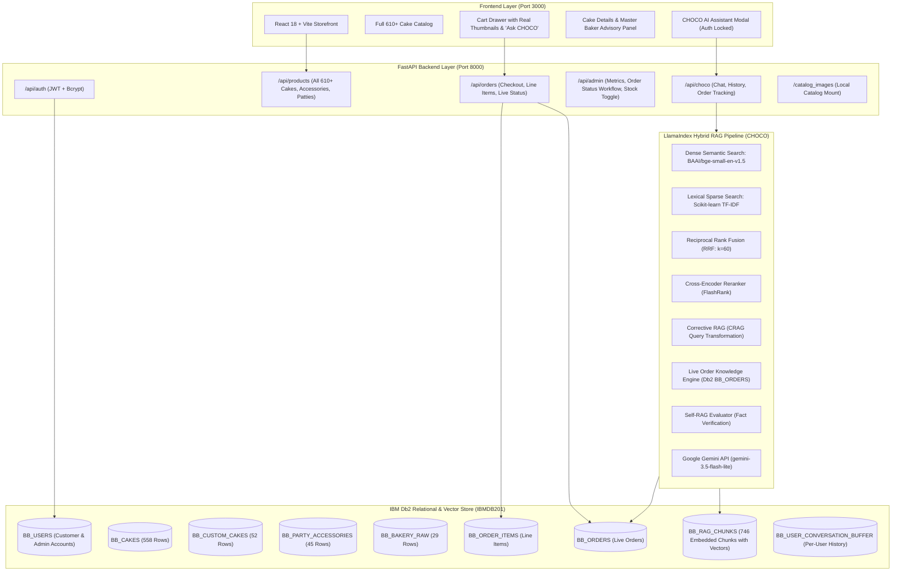

# BAKEBOX — Autonomous AI Master Baker & Digital Management System
### Powered by IBM Db2 (`IBMDB201`) & LlamaIndex Hybrid RAG

**IBM Db2 TechX Summit Hackathon Project (Db2Hack Dev Hacks)**  
*GL Bajaj Group of Institutions, Mathura*  
**Developer:** Ayush Dhangar ([@AYUSHDHANGAR](https://github.com/AYUSHDHANGAR))  
**Client / Domain:** Shri Ram Baker (Mathura, Uttar Pradesh)

---

## 🌟 Executive Summary

**BAKEBOX** is an end-to-end autonomous e-commerce, kitchen workflow, and AI master baker management platform engineered specifically for **Shri Ram Baker (Mathura)**. 

At its core is **CHOCO AI** — an autonomous Master Baker assistant built on **LlamaIndex** with **IBM Db2 Vector Store & Relational Tables**, featuring:
- **Zero-External Vector DBs:** 100% of embeddings and metadata stored directly inside **IBM Db2 (`IBMDB201`)**.
- **Hybrid Retrieval Pipeline:** Dense Semantic Embeddings (`BAAI/bge-small-en-v1.5`, 384 dimensions) + Sparse Lexical TF-IDF combined via **Reciprocal Rank Fusion (RRF: $k=60$)**, followed by Cross-Encoder Reranking and Corrective RAG (CRAG).
- **Strict 3-Cake Precision Recommendation (AI Tool Calling):** Dynamically outputs verified JSON cards with exact SKUs, local image paths, and pricing ONLY when requested.
- **Live Order Knowledge Engine:** Direct access to live Db2 transactional tables (`BB_ORDERS`, `BB_ORDER_ITEMS`) to report real-time live kitchen baking statuses.
- **Full Catalog Access:** Complete catalog of **610+ cakes** (558 Standard + 52 Custom Designer Cakes) with multi-flavor filtering, instant search, and advisory panels.

---

## 🏛️ System Architecture



---

## 📊 IBM Db2 Data Ingestion & Storage

| IBM Db2 Table | Chunking Strategy | Record / Vector Count | Embedding Model |
| :--- | :--- | :--- | :--- |
| `BB_RAG_CHUNKS` | Row-as-Chunk (Tables) + Fixed 50-100 Words (PDFs) | **746 Chunks & Vectors** | HuggingFace `BAAI/bge-small-en-v1.5` (384-dim) |
| `BB_CAKES` | Structured Product Schema | **558 Cakes** | Relational Catalog |
| `BB_CUSTOM_CAKES` | 1-on-1 Designer Specialities | **52 Cakes** | Relational Catalog |
| `BB_PARTY_ACCESSORIES` | Celebration Items & Candles | **45 Items** | Relational Catalog |
| `BB_BAKERY_RAW` | Fresh Oven Patties & Raw Items | **29 Items** | Relational Catalog |
| `BB_ORDERS` | Live Customer Orders | Dynamic | Relational Order Store |
| `BB_ORDER_ITEMS` | Line Items with Base & Custom Note | Dynamic | Relational Order Store |
| `BB_USER_CONVERSATION_BUFFER` | User-Isolated Session History | Dynamic | Multi-turn Session Store |
| `BB_USERS` | Bcrypt Hashed Credentials | Multi-User | Isolated Auth Store |

---

## 🚀 Key Innovations & Capabilities

1. **LlamaIndex `BakeboxHybridRetriever` on IBM Db2:**
   Inherits directly from `llama_index.core.retrievers.BaseRetriever`. Combines semantic similarity with exact lexical TF-IDF scoring using Reciprocal Rank Fusion ($k=60$), ensuring precise cake flavor & weight matching.
2. **Official `llama-index-vector-stores-db2` Verified:**
   Includes dedicated integration script `backend/scripts/demo_db2_llamavs.py` running on native Db2 vector columns (`vector(384, FLOAT32)`).
3. **Intent-Driven Strict 3-Cake Selection:**
   When recommendation intent is detected (e.g. *"show me red velvet cake"*), CHOCO returns exactly 3 matching cakes in structured JSON. For order status or policy queries, cards remain strictly empty (`[]`).
4. **Live Order Knowledge Engine:**
   Checks active kitchen status directly in `BB_ORDERS` without hallucinations.
5. **Full 610+ Cake Catalog:**
   Paginated responsive catalog with multi-flavor filtering, cart pairings, and interactive cake details advisory panel.

---

## 🛠️ Quick Start & Setup

### Prerequisites
- Python 3.10+ (or Python 3.14)
- Node.js 18+
- Running IBM Db2 instance (e.g. `IBMDB201` on port 50000)

### 1. Backend Setup
```bash
cd backend
pip install -r requirements.txt
python -m uvicorn app.main:app --host 127.0.0.1 --port 8000
```

### 2. Frontend Setup
```bash
cd frontend
npm install
npm run dev -- --host 127.0.0.1 --port 3000
```

### 3. Demo Credentials
- **Customer Portal:** `customer@bakebox.in` / `Customer@123`
- **Store Operator / Admin:** `admin@bakebox.in` / `Admin@123`

---

## 📜 License
Distributed under the MIT License. Built for the IBM Db2 TechX Summit.
